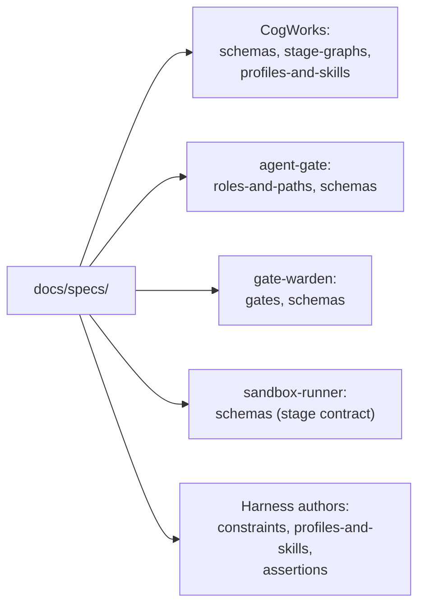

# Harness specification

The harness is the versioned product that tells the Brightsmiths factory's discipline-neutral
core what to do. It contains:

- agent profiles;
- skills;
- stage graphs;
- gate definitions;
- roles;
- cross-service schemas;
- constitutional rules.

Content is organised as a neutral core plus discipline packs, and Brightsmiths maintains only
`disciplines/software/`. Target repositories pin a released version. CogWorks, agent-gate,
sandbox-runner and gate-warden read that pinned version and enforce it. No agent can change the
rules it runs under.

The system-level architecture is in the handbook,
[brightsmiths/handbook `docs/`](https://github.com/brightsmiths/handbook/tree/feat/initial/docs).
This spec covers only the harness.

## Reading order

| # | File | What it covers |
| --- | --- | --- |
| 1 | [overview.md](overview.md) | System context, scope, non-goals, handbook references |
| 2 | [vocabulary.md](vocabulary.md) | Domain concepts and failure conditions |
| 3 | [requirements.md](requirements.md) | Increments L1–L4 and the "must not" rules, with IDs |
| 4 | [architecture.md](architecture.md) | Repository layout, core vs pack boundary, dependency rules |
| 5 | [responsibilities.md](responsibilities.md) | CRC cards per artifact kind; consumer matrix |
| 6 | [schemas.md](schemas.md) | Field-level contracts of every cross-service format |
| 7 | [roles-and-paths.md](roles-and-paths.md) | `roles.yaml`, Rust path conventions, harness-as-target role |
| 8 | [profiles-and-skills.md](profiles-and-skills.md) | Profile anatomy, persona rules, porting from Tester/Coder, catalogues |
| 9 | [gates.md](gates.md) | Gate principles, G6-lite, gates by level, thresholds |
| 10 | [stage-graphs.md](stage-graphs.md) | Graph rules, the T1 pilot graph, later graphs |
| 11 | [operations.md](operations.md) | Releases, pinning, canary, withdrawal, evals |
| 12 | [security.md](security.md) | Threat model and repository controls |
| 13 | [testing.md](testing.md) | CI validation, consumer dry runs, evals |
| 14 | [assertions.md](assertions.md) | Given/When/Then assertions |
| 15 | [edge-cases.md](edge-cases.md) | Failure modes; fail-closed behaviour |
| 16 | [constraints.md](constraints.md) | Hard rules for all content |
| 17 | [tradeoffs.md](tradeoffs.md) | Alternatives considered |
| 18 | [assumptions.md](assumptions.md) | Challenged assumptions; open items with owners |

Decisions: [ADRs](../adr/README.md).

## Increment map

| Level | Milestone | Main content | Built by |
| --- | --- | --- | --- |
| L1 | M1 | Core schemas (proposed); `unit-oracle` and `implement` profiles; L1 skills; `roles.yaml` (oracle, builder); G6-lite; T1 pilot graph; core constitutional rules; release v0.x | Humans |
| L2 | M3 | `specify`, `contract`, `plan`; G1, G3, G4 (and G5); design skills; designer and `harness-author` roles; signed releases | Factory + H8 |
| L3 | M6 | `architect`, `acceptance-oracle`, `refactor`, `review-*`; T2 graph and thresholds; holdout policy | Factory + H8 |
| L4 | M7 | `drift-scan`, `debt-fix`; evals interface; canary procedure; formal pack interface; T3 | Factory + H8 |

## Who reads what

## Next steps

1. **Consumer review.** CogWorks, agent-gate, sandbox-runner and gate-warden review
   [schemas.md](schemas.md) and [roles-and-paths.md](roles-and-paths.md). Their approval moves
   schemas from *proposed* to *accepted*.
2. **Open items.** Resolve the open items in [assumptions.md](assumptions.md) with the owners
   named there, before the L1 work items that depend on them.
3. **L1 work items.** Turn requirements HR-L1-01…13 into GitHub issues in dependency order:
   1. repository protections and CI (HR-L1-12, -13);
   2. schemas (-01…-03);
   3. constitutional rules (-10);
   4. roles (-07);
   5. skills and profiles (-06, -04, -05);
   6. G6-lite (-08);
   7. T1 graph (-09);
   8. first release (-11).
