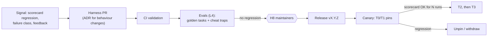

# Operations: release, pinning and rollout

The harness has no runtime to operate. Operating it means changing it safely: releases, pins,
rollout, withdrawal and evaluation (handbook `docs/architecture/operations.md`, "Changing the
harness safely").

## Releases

| Aspect | Rule |
| --- | --- |
| Versioning | SemVer for the whole harness ([ADR-0004](../adr/ADR-0004-single-semver-version.md)) |
| Commits | Conventional commits; a `!` or `BREAKING CHANGE:` footer is required for schema breaks |
| Release mechanics | release-regent: rolling release PR, CHANGELOG, tag, GitHub Release |
| Release approval | Merging the release PR is an H8 decision by a maintainer |
| Tag protection | `v*` tags cannot be deleted or moved ([ADR-0005](../adr/ADR-0005-distribution-and-pinning.md)) |
| Signing | From L2: archive digest plus Ed25519 signature; DSSE via chain-chronicler when available |
| Pre-1.0 | `0.y.z` during M1–M3. Minor bumps may break schemas but must say so in the CHANGELOG. `1.0.0` once all L2 schemas are accepted |

The CHANGELOG lists, for each release:

- schema changes, with their compatibility class;
- profiles, skills, gates and graphs added or changed;
- threshold changes;
- consumer actions required.

## Pinning

- Each target repository pins one version in `.factory/pin.yaml`. The pin is human-owned
  (handbook `docs/architecture/state-model.md`).
- Moving a pin is a PR in the target repository. It is reviewed by that repository's tech lead
  and needs no harness involvement.
- CogWorks and gate-warden read the pin from the target repository's **default branch**. A pin
  changed inside a PR has no effect on that PR's gates.
- The harness repository pins a released harness version for its own PRs
  ([ADR-0006](../adr/ADR-0006-write-protection-model.md)).

## Rollout (canary, L4)

Before L4, rollout is manual: maintainers move the pilot repository's pin and watch the
outcomes. From L4:

1. **Release.** Evals pass: no golden-task regression and no cheat-trap "pass".
2. **Canary.** Selected T0/T1 repositories move their pins.
3. **Observe.** The scorecard is compared with the previous version, sliced by harness
   version, profile and prompt hash (handbook operations page). Metrics include:
   - gate pass rate;
   - attempts per slice;
   - escalation rate;
   - visible-vs-holdout gap;
   - sniff hits;
   - cost per merged slice.
4. **Widen.** T2 repositories after N runs without regression, then T3. N and the regression
   bounds are set in the rollout procedure document (HR-L4-03).
5. **Roll back.** Revert pins to the previous version, then withdraw if needed.

## Withdrawal

A released version found to be unsafe is **withdrawn**, never deleted or re-tagged:

- The GitHub Release is marked as withdrawn, with the reason and the replacement version.
- A withdrawn-versions list in the next release, and the release notes, name it.
- Consumers report `HARNESS_VERSION_WITHDRAWN` for new runs. Verdicts already recorded stand.
  Re-running gates on old SHAs with a withdrawn version is a human decision.

## Kill switches

Kill switches are GitHub-visible state owned by CogWorks (handbook operations page). The
harness supplies the identifiers they refer to:

| Scope | Identifier |
| --- | --- |
| Profile | `<discipline>/<profile>` (all versions) or `<discipline>/<profile>@<version>` |
| Harness version | `harness@<version>` |
| Global | outside the harness |

## Evals interface (L4)

The evals repository (working name `harness-evals`) holds golden tasks and cheat traps per tier.
The harness defines only:

- the release rule: a harness release needs a passing eval run for its exact commit SHA;
- the trigger: every harness PR that changes `disciplines/**`, `schemas/**` or
  `constitutional-rules/**`, and every model-version change in the gateway;
- the result: an eval report attached to the release PR as evidence for H8.

## Learning loop

A recurring gate-failure class or dispute pattern leads to a proposal for a new check, rule or
skill. A human approves it. Agents may draft harness PRs as `harness-author` (L2+), but only H8
merges them.
