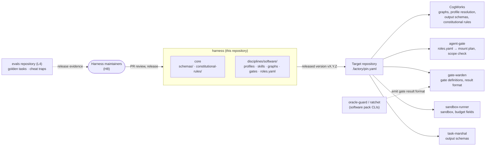

# Overview

## What the harness is

Brightsmiths is a set of small, independent services and agent profiles that together take
engineering work from a GitHub issue to a merged pull request and a published GitHub Release.
Its core rule is that **an LLM is a component inside a deterministic machine, never the machine
itself**. Deterministic services decide what runs, what each agent may see and touch, and
whether output passes. Agents only produce artifacts. (See the handbook,
[brightsmiths/handbook `docs/overview.md`](https://github.com/brightsmiths/handbook/blob/feat/initial/docs/overview.md).)

The **harness** is the versioned product that tells that deterministic machine *what to do*. It
holds definitions only:

- **Agent profiles**: persona, skills and stage contract for each stage type.
- **Skills**: guidance documents that profiles load.
- **Stage graphs**: one per tier, defining which stages and gates run in which order.
- **Gate definitions**: the checks (commands) and thresholds per tier that gate-warden runs.
- **Roles**: the identity roles and path conventions that agent-gate enforces.
- **Schemas**: the cross-service file formats (stage contract, gate result, gate definition,
  stage graph, roles, pin file, risk map, stage outputs).
- **Constitutional rules**: non-overridable rules loaded before any context.

Content is organised into a discipline-neutral **core** (`schemas/`, `constitutional-rules/`)
and per-discipline **packs** under `disciplines/<name>/`. Brightsmiths maintains only the
software pack (`disciplines/software/`), Rust first.

Repositories that the factory works on pin a harness version in `.factory/pin.yaml`. From L4
(milestone M7), harness releases are evaluated against golden tasks and cheat traps and rolled out
by canary.

## System context

Consumers read the harness at a **pinned, released version**. No consumer reads the harness
from an open pull request, and nothing in the harness is executable service code.

## Scope

In scope:

- Definitions for the software pack at the levels listed in [requirements.md](requirements.md).
- The canonical definitions of the cross-service schemas (see [ADR-0002](../adr/ADR-0002-harness-owns-cross-service-schemas.md)).
- The release, pinning and rollout procedure for the harness itself ([operations.md](operations.md)).
- The roles mapping that applies when the harness repository is itself the target of a factory
  run ([roles-and-paths.md](roles-and-paths.md#harness-repository-as-a-run-target)).

Out of scope (non-goals):

- **Service code.** The harness never contains executable services, gate implementations or
  adapters. Validation in CI uses off-the-shelf tools ([testing.md](testing.md)).
- **Holdout content.** Holdout tests live in private holdout repositories per deployment. The
  harness holds only the holdout *policy* (L3).
- **Golden tasks and cheat traps.** These live in a separate evals repository (L4); the harness
  defines only the interface to it.
- **Other disciplines' content.** Other packs may live in their own repositories and be
  referenced by version.
- **Deployment and runtime operation** of any service.

## Who builds it

| Level | Milestone | Built by |
| --- | --- | --- |
| L1 | M1 | Humans (human-led bootstrap) |
| L2–L4 | M3, M6, M7 | The factory, with every PR reviewed by harness maintainers (H8) |

The harness is a control-plane repository. It is treated as T2+ whoever builds it: every PR
gets a human review, and gate-warden reads gate configuration from a released harness version,
never from the PR it judges (handbook `docs/roadmap.md`, bootstrap rule 5).

## Handbook references

The system architecture this spec relies on is in
[brightsmiths/handbook](https://github.com/brightsmiths/handbook) under `docs/` (branch
`feat/initial` until merged):

| Page | Used for |
| --- | --- |
| `docs/architecture/agent-profiles.md` | Profile anatomy, selection, trust zones, visibility and write matrix |
| `docs/architecture/workflow.md` | Stages, gate catalogue G1–G9, human touchpoints H1–H8 |
| `docs/architecture/oracles.md` | Oracle rules, Rust locking conventions, manifest |
| `docs/architecture/state-model.md` | Per-repository factory files, label namespaces |
| `docs/architecture/isolation-and-security.md` | Sandbox model, provenance fields |
| `docs/architecture/operations.md` | Changing the harness safely, evals, kill switches |
| `docs/roadmap.md` | Milestones and bootstrap rules |
| `docs/adr/ADR-0003`, `ADR-0004`, `ADR-0006`, `ADR-0007` | Trust zones, gate-warden verdicts, tiers, discipline packs |
