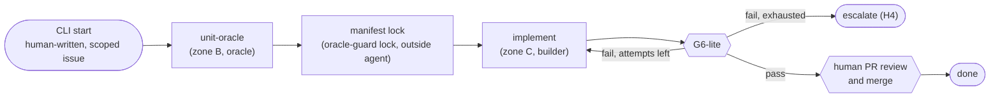

# Stage graphs

A stage graph defines, for one tier, which stages and gates run and in what order. CogWorks walks
it as a step function over GitHub state (handbook ADR-0002): labels, sub-issues, PR merge state
and gate-warden check runs. Graphs never carry state. The format is in
[schemas.md](schemas.md#stage-graph).

One file per tier: `disciplines/<d>/graphs/t0.yaml` … `t3.yaml`. Stages that a tier skips are
absent from that tier's graph (handbook `docs/architecture/workflow.md`).

## Rules

1. Every `stage` node's `stage_type` must resolve to a profile for that tier
   ([ADR-0009](../adr/ADR-0009-profile-naming-and-resolution.md)).
2. Every `gate` node's gate must have a definition whose `applies_to` includes the tier.
3. Each stage node is followed by at least one gate node before the graph can reach `done`.
   No stage output reaches `done` without a gate-warden verdict.
4. Retry edges are bounded by the profile's `retries.max_attempts`. When attempts are exhausted
   the edge goes to `escalate` (H4).
5. The graph is acyclic apart from retry edges.
6. Human touchpoints are nodes that wait for GitHub state: a review by an authorised human,
   checked by gate-warden.
7. A tier may not have fewer gates than the tier below it; this is checked across files.

## T1 pilot graph (L1)

For the M1 pilot (commit-gate):

- A human writes and scopes the issue and the contracts.
- A human starts the run from the CLI.
- unit-oracle writes locked tests; the manifest is locked.
- implement runs per slice, then G6-lite.
- A human reviews and merges.



```yaml
schema: urn:brightsmiths:harness:stage-graph:1
tier: t1
entry: { trigger: cli }
nodes:
  - { id: oracle, kind: stage, stage_type: unit-oracle }
  - { id: build,  kind: stage, stage_type: implement }
  - { id: g6,     kind: gate,  gate: G6-lite }
  - { id: review, kind: human, touchpoint: merge-review }
edges:
  - { from: oracle, to: build }
  - { from: build,  to: g6 }
  - { from: g6, to: build,    on: fail, when: attempts_left }
  - { from: g6, to: escalate, on: fail, when: attempts_exhausted }
  - { from: g6, to: review,   on: pass }
  - { from: review, to: done }
```

L1 has no gate after `oracle` before `build`. The oracle's output is checked by `oracle-verify`
and `oracle-inventory` inside G6-lite. This means a locked test that cannot fail (asserts
nothing) is not caught at L1. G5 (red-check) closes this gap at L2. See
[assumptions.md](assumptions.md), AS-06.

L1 runs on one slice per issue. Plans and slices arrive with `plan` at L2.

## T1 graph (L2)

Adds the design stages and the event trigger:

```text
trigger label → specify → G1 → H1 → contract → G3 → plan → G4 → (sub-issues per slice)
  → unit-oracle → G5 → implement (per slice) → G6-lite → merge review
```

## T2 graph (L3)

Follows the handbook flow for T2:

```text
specify → G1 → H1 → architect → G2 → H2 → contract → G3 → H3 → plan → G4
  → [acceptance-oracle ∥ unit-oracle] → G5 → implement (per slice) → G6
  → refactor → G7 → [review-semantic ∥ review-security] → G8 → H5 (hot zones) → merge
```

## T0 and T3

- `t0.yaml` is the L1 T1 graph with G6-lite's T0 thresholds. It is created at L1 only if a
  pilot needs it.
- `t3.yaml` (L4) adds two-approver H1, a second H3 reviewer, an independent acceptance owner,
  and the T3 profile variants.
